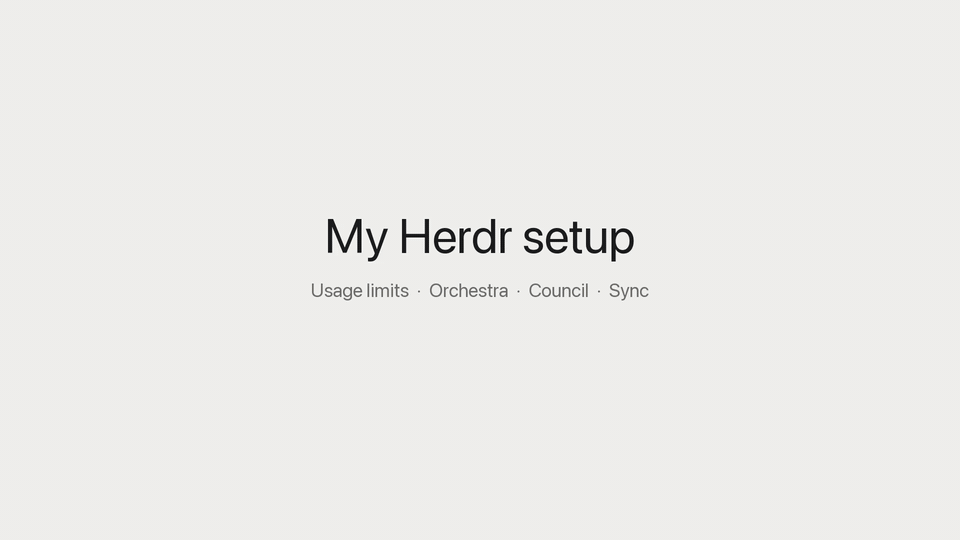
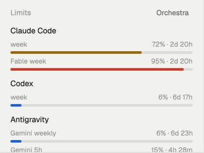
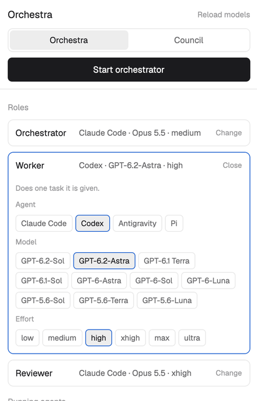
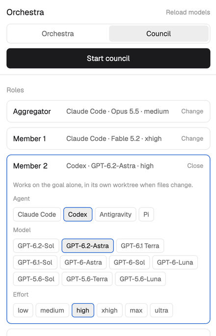

# My Herdr setup

My setup for [Herdr](https://herdr.dev), the app for running coding agents side by side. It adds three things to Herdr:

- **Limits**: how much of Claude Code, Codex and Antigravity you have left, always in the sidebar.
- **Orchestra**: one agent plans and hands the work to other agents, then one reviewer checks it all.
- **Council**: three agents solve the same goal on their own, and an aggregator combines the best of each.

The setup syncs between my Macs through this repo every 5 minutes.



[Watch the full-quality video](docs/demo.mp4)

## Limits



The sidebar shows one bar per tool: the limit that is closest to running out. Click a tool to see all of its limits. The panel refreshes every 2 minutes.

- **Claude Code**: the weekly limit and any per-model limit, such as the Fable week. Herdr reads these from Claude Code's own `/usage` page, which uses no model and none of your quota.
- **Codex**: the 5-hour and weekly limits from your latest Codex session.
- **Antigravity**: every quota group, asked from the running Antigravity app. When Antigravity is closed, the panel shows the last numbers it saw.

A number older than a day is marked in red, so you know it may be wrong.

<br clear="right">

## Orchestra



Open the panel with **Orchestra** in the Limits header, or press `cmd-shift-o`. For each role, pick an agent (Claude Code, Codex, Antigravity or Pi), a model and an effort level. Then press **Start orchestrator**.

- The **orchestrator** never does the work. It splits your goal into tasks and starts a **worker** for each one, with at most 3 at a time. Workers that change files each get their own git worktree.
- When every worker has reported, a single **reviewer** checks all the work together.
- The orchestrator reads the review itself and decides what to fix. It sends fixes back to the worker that did that part. It asks you only about things that are yours to decide: deploying, publishing, merging into your branch, spending money or deleting data.
- Helpers close as soon as they are no longer needed. When you say the goal is done, the rest close too.

You can also make an agent that is already running the orchestrator: use its switch under **Running agents**.

<br clear="right">

## Council



Switch the panel to **Council** to give one goal to three different agents. It works for fixing a bug, writing a plan, a document, or anything else.

1. The **aggregator** gives the same brief to the three **members**. They work alone; for code, each gets its own git worktree and branch.
2. The aggregator compares the three answers itself. It picks the best one as the base and takes the strong parts from the other two.
3. For code, the base member adds those parts to its branch. Another member then checks the result against the goal.
4. You get one answer: the plan, the document or the branch to merge. It also says what came from which member and where they disagreed.

Mixing agents, for example Claude Code, Codex and Antigravity, gives more varied answers. A council costs about three times one agent, so use it for hard or open questions.

<br clear="right">

## Local models with Pi

[Pi](https://www.npmjs.com/package/@mariozechner/pi-coding-agent) can be the agent for any role. The panel lists the models from `~/.pi/agent/models.json`, such as Ollama, LM Studio or vLLM models. Install Pi, add your models, and click **Reload models**.

## Install on a Mac

You need Herdr, git, and the GitHub CLI signed in (`gh auth login`). Then run:

```sh
gh repo clone LGuillermoAngaritaG/herdr-config /tmp/herdr-config && /tmp/herdr-config/install.sh
```

The installer:

- puts the setup in `~/.config/herdr-app`, and saves any files it replaces to `~/.config/herdr-app-before-sync`;
- starts a background job that syncs every 5 minutes;
- switches Herdr to the `main-plus` layout.

To use my setup without syncing back to this repo, fork it first and pass your fork's URL to `install.sh`.

### Sync

Every 5 minutes, each Mac saves its changes, gets the other Macs' changes, and pushes. Run `~/.config/herdr-app/sync.sh` to sync right away. The log is `~/Library/Logs/herdr-sync.log`.

If two Macs change the same line, sync stops and shows a notification. Nothing is overwritten. Fix the file, then delete `.git/sync-stopped`.

Only the files you own are synced. Herdr's built-in files and each Mac's own state stay out: window size, open tabs and panel memory.

## What is in this repo

| Path | What it is |
|---|---|
| `mods/limits/` | The Limits panel. `usage.py` reads the numbers. |
| `mods/orchestra/` | The Orchestra and Council panel. `models.py` lists each agent's models. It writes the helper roles to `~/.config/herdr-core/templates/`. |
| `layouts/main-plus.json` | The main layout with the Limits and Orchestra panels added. |
| `layouts/kanban.json`, `layouts/coordinator.json` | Other layouts. Kanban comes from [dougcunha/herdr-mods](https://github.com/dougcunha/herdr-mods) (MIT). Their panels are not in this repo yet. |
| `keys.json`, `settings.json`, `themes/` | Shortcuts, settings and themes. |
| `sync.sh`, `install.sh` | Sync and setup. |

### Commands

Bind these in `keys.json`, or run them with `herdr-app do <command>`:

| Command | What it does |
|---|---|
| `limits.orchestra` | Show or hide the Orchestra panel (`cmd-shift-o`). |
| `limits.refresh` | Read the limits again now. |
| `limits.expand`, `limits.collapse` | Show every limit, or only the main bar. |
| `orchestra.orchestra`, `orchestra.council` | Switch the panel's mode. |
| `orchestra.open-<role>` | Open a role's choices, for example `orchestra.open-worker`. |

## Limits of this setup

- It is macOS only: the sync job and its notifications use macOS features.
- The Antigravity numbers come from a local endpoint that is not official, so an Antigravity update may break them.
- The Claude numbers come from the text of Claude Code's `/usage` page. If that text changes, the panel falls back to the numbers that the status-bar plugin saves.
- Only a Claude Code orchestrator or aggregator is locked out of editing files. With other agents, only their instructions hold them back.
